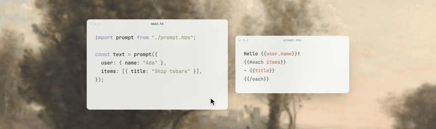

# tsbars



Import `.hbs` files from TypeScript and get a call signature inferred from the template.

`prompt.hbs`:

```hbs
Hello {{user.name}}!
{{#if user.admin}}You are an admin.{{/if}}
{{#each items}}- {{title}}
{{/each}}
```

`index.ts`:

```ts
import prompt from './prompt.hbs';

prompt({ user: { admin: true }, items: [{ title: 'Write docs' }] });
```

```text
index.ts(3,10): error TS2741: Property 'name' is missing in type '{ admin: true; }' but required in type '{ name: Printable; admin?: unknown; }'.
```

The import is typed as `(context: Context) => string`, where `Context` is:

```ts
type Printable = string | number | bigint | boolean;
type Context = {
	user: { name: Printable; admin?: unknown };
	items: ReadonlyArray<{ title: Printable }>;
};
```

A [TypeScript content mapper](https://github.com/microsoft/typescript-go/pull/4712) does the inference: the compiler hands it the template, it returns a virtual `.ts` module, and errors are mapped back to the template. At runtime the template is compiled by Handlebars through a Vite or Bun plugin.

## Requirements

- TypeScript `7.1.0-beta` (the native compiler), run as `tsc --noEmit --runExternalCode`.
- Node.js with `node:wasi`. The mapper is a bundled WebAssembly module that `bin/mapper.js` runs under it. CI uses Node 26; older versions are untested.
- [Handlebars](https://handlebarsjs.com) `^4.7.0` as a peer dependency.
- Imports must include the `.hbs` extension.

No Rust toolchain or build step is needed to use tsbars.

## Install

Once published to npm (it isn't yet):

```sh
pnpm add -D tsbars typescript@7.1.0-beta
pnpm add handlebars
```

Vite is an optional peer dependency, only needed for `tsbars/vite`. To try tsbars before the first release, see [Development](#development).

## Setup

Add a content mapper to your `tsconfig.json`:

```jsonc
{
	"compilerOptions": {
		"module": "NodeNext",
		"moduleResolution": "NodeNext",
		"strict": true,
		"noEmit": true
	},
	"contentMappers": [
		{
			"package": "tsbars",
			"extensions": [".hbs"],
			"options": { "helpers": ["now"] }
		}
	]
}
```

`options.helpers` lists helpers you call without arguments (`{{now}}`). Without it, a bare `{{now}}` is read as a context variable and becomes a required property.

Type-check with:

```sh
tsc --noEmit --runExternalCode
```

`examples/basic` is a working project.

<details>
<summary>Editor support (not tested by us yet)</summary>

Content mappers are external code, so the editor has to opt in. In VS Code this should mean:
- the TypeScript Native Preview extension,
- a trusted workspace, with the content mapper permission granted,
- `js/ts.contentMappers.enabled` turned on.

We haven't verified this in an editor. Only the `tsc` path above is covered by tests.

</details>

## Runtime

Both plugins take [Handlebars compile options](https://handlebarsjs.com/api-reference/compilation.html) and pass them to `Handlebars.precompile`.

```ts
// vite.config.ts
import tsbars from 'tsbars/vite';

export default {
	plugins: [tsbars({ noEscape: true })],
};
```

```ts
// preload.ts, referenced from bunfig.toml: preload = ["./preload.ts"]
import { plugin } from 'bun';
import tsbars from 'tsbars/bun';

plugin(tsbars({ noEscape: true }));
```

Use `noEscape: true` for LLM prompts. Handlebars HTML-escapes `{{value}}` by default, so `<` and `&` in your data would come out as `&lt;` and `&amp;`.

Compiled templates use `handlebars/runtime`, so register helpers there:

```ts
import Handlebars from 'handlebars/runtime';

Handlebars.registerHelper('shout', (text: string) => text.toUpperCase());
```

The helper must be registered before the template runs. tsbars doesn't see it, so list it in `options.helpers` if you call it with no arguments.

## How types are inferred

| Template                                                 | Inferred                                                                    |
| -------------------------------------------------------- | --------------------------------------------------------------------------- |
| `{{a.b}}`                                                | `a: { b: Printable }`                                                       |
| `{{#if a}}`, `{{#unless a}}`, `{{else if a}}`            | `a?: unknown`, or `a?: <type from other uses>`                              |
| `{{#each xs}}{{title}}{{/each}}`                         | `xs: ReadonlyArray<{ title: Printable }>`                                   |
| `{{#each xs}}{{this}}{{/each}}`                          | `xs: ReadonlyArray<Printable>`                                              |
| `{{#each xs}}{{@key}} {{this}}{{/each}}`                 | `xs: Readonly<Record<string, Printable>>`                                   |
| `{{#each xs as \|x i\|}}{{x.id}}{{/each}}`               | `xs: ReadonlyArray<{ id: Printable }>` (first block param names the item)   |
| `{{#with a}}{{b}}{{/with}}`                              | `a: { b: Printable }`; optional if the block has `{{else}}`                 |
| `{{../b}}` inside a block                                | `b` is looked up in the parent scope, one level per `../`                   |
| `{{@root.b}}`                                            | `b` on the root context                                                     |
| `{{shout name}}`, `{{upper (trim raw)}}`                 | `name: unknown`, `raw: unknown`; the helper itself is not part of `Context` |
| `{{lookup obj key}}`                                     | `obj: unknown`, `key: Printable`                                            |
| `{{#fancy z}}{{inner}}{{/fancy}}` (unknown block helper) | `z: unknown`; the body adds nothing                                         |
| `{{now}}` with `"helpers": ["now"]`                      | nothing                                                                     |
| no variables at all                                      | `context?: Record<string, never>`                                           |

Notes:
- `Printable` is `string | number | bigint | boolean`. A path that is both printed and used as an object (`{{a}}` and `{{a.b}}`) becomes the object.
- Property names that aren't valid identifiers (`{{[odd key]}}`) become quoted keys.
- Properties are listed in the order the template first mentions them.

### Overriding inference

Top-level comments can replace an inferred type or import one:

```hbs
{{!-- @import type { User } from "./user" --}}
{{!-- @param user User --}}
{{!-- @param stats.count number --}}
Hello {{user.name}}, you have {{stats.count}} messages.
```

- `@param <path> <type>` replaces the inferred type at that dotted path with any TypeScript type.
- `@import <clause>` emits `import <clause>;` into the generated module. The clause is whatever follows `import`, for example `type { User } from "./user"`.
- A type error inside an annotation is reported on the template line (`profile.hbs(1,23): error TS2304: Cannot find name 'Missing'.`).
- A malformed directive is reported as `tsbars2` against the template.

## Limitations

- Partials contribute no types: `{{> name}}` and `{{#> name}}...{{/name}}` are skipped, including everything inside a partial block. Variables used only there won't appear in `Context`.
- Decorators (`{{* ... }}`) and inline partials (`{{#*inline "x"}}`) are not supported. They are parse errors.
- Helpers have no signatures. Their arguments are typed `unknown`, and nothing checks the helper exists.
- A template that fails to parse is reported as `tsbars1` (for example `broken.hbs(2,1): error tsbars1: Block \`if\` is not closed`). Its default export then accepts `any`, so importers don't produce more errors.
- Content mappers are a beta TypeScript feature and may change.
- Not published to npm yet, and editor support is untested.

## Development

Prerequisites: [pnpm](https://pnpm.io), [Bun](https://bun.sh) (test runner), and [rustup](https://rustup.rs). rustup installs the toolchain and the `wasm32-wasip1` target from `rust-toolchain.toml` on first use.

```sh
pnpm install
pnpm run build    # tsdown -> dist/, then the mapper -> wasm/tsbars-mapper.wasm
pnpm run check    # tsc, Biome lint, clippy, bun test, cargo test
pnpm run format   # Biome + cargo fmt
```

`bin/mapper.js` exits with a hint to run `pnpm run build:wasm` if `wasm/tsbars-mapper.wasm` is missing. To use a clone from another project, symlink it to that project's `node_modules/tsbars` (tsc only resolves content mapper packages from `node_modules`; the e2e tests do the same).

CI auto-commits formatting on pull requests, then runs `pnpm run check`. See [AGENTS.md](AGENTS.md) for the repo layout.

<details>
<summary>Releasing</summary>

Add a changeset with your change:

```sh
pnpm exec changeset
```

Merging it to `main` opens a "Version Packages" PR; merging that PR publishes to npm through GitHub Actions with OIDC trusted publishing. The first publish has to be done manually, then a trusted publisher configured on npmjs.com.

</details>

## Acknowledgements

tsbars is modelled on [reylo](https://github.com/colinhacks/reylo) by Colin McDonnell (MIT). Its content-mapper server, packaging and typed-import design were the reference. tsbars reimplements that approach in Rust for Handlebars.

Thanks to the TypeScript team for content mappers ([microsoft/typescript-go#4712](https://github.com/microsoft/typescript-go/pull/4712)).

## License

[MIT](LICENSE)
